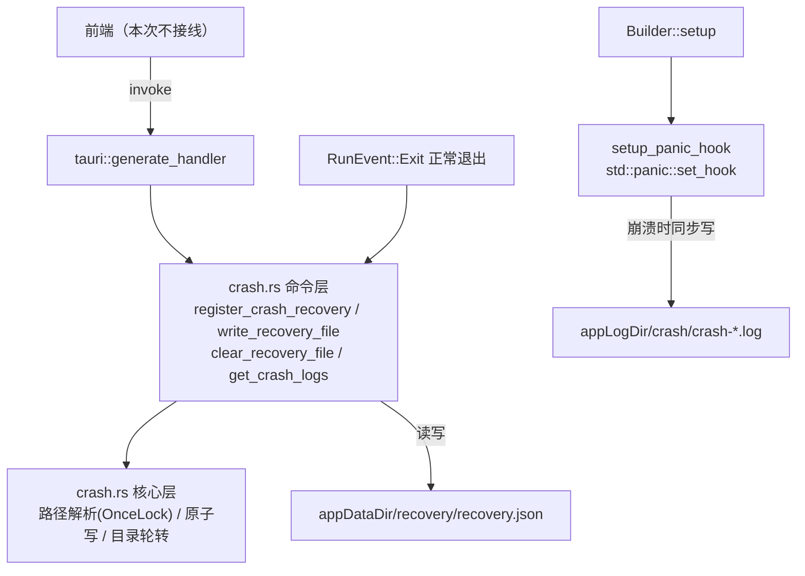

## 产品概述

在 Tauri 后端（Rust 侧）补齐文档 `tarui_api_requires.md` 第二十一节「崩溃恢复」中的自写能力，为后续草稿自动保存与崩溃排查提供底层支撑，本次不接前端、不做崩溃上报。

## 核心功能

- 崩溃检测：启动时检查上次运行是否留下恢复文件，若有则判定为异常退出并返回草稿数据供后续恢复
- 草稿落盘：接收任意 JSON 数据写入恢复文件，采用临时文件 + 重命名的原子写，避免写入过程崩溃导致文件损坏
- 正常退出清理：干净退出时删除恢复文件，保证"有文件 = 崩过"这一判定成立
- panic 捕获：安装 panic 钩子，把 panic 信息、线程、时间写入独立崩溃日志文件
- 崩溃日志列表：按时间倒序列出本地崩溃日志文件（名称、路径、大小、修改时间），供后续排查或展示
- 明确不做：`reportCrash` 上报

## 边界与约束

- 只允许改动 `src-tauri/` 下的文件，前端 `d:/CodeProject/kurumichan/src`（Vue/TS）全程不动，不在前端发起 invoke、不改 store、不新增 npm 包
- 不新增第三方 crate，复用现有 serde / serde_json

## 技术栈

- 现有栈：Tauri 2（Rust edition 2024）+ `tauri-plugin-opener` 2 + serde/serde_json；前端 Vue3 + Pinia（**禁止改动**）
- 依赖策略：零新增 crate，时间用 `std::time::SystemTime` 毫秒戳，路径用 Tauri 2 的 `Manager::path()`（`app_data_dir()` / `app_log_dir()`）

## 实现方案

在 `src-tauri/src/crash.rs` 新建独立模块，集中管理路径、恢复文件、panic 钩子；`lib.rs` 仅做模块声明、命令注册与 setup 接线，保持入口文件精简、职责分离（SRP）。

关键决策：

1. **路径在 `setup` 阶段解析一次并缓存到 `OnceLock`**：panic 钩子运行在崩溃现场，不能触碰 `AppHandle`、不能走异步、不能分配过多资源，只能做纯同步 `std::fs` 写入。这是保证 panic 时日志能落盘的核心前提。
2. **恢复文件判定语义**：正常退出主动删除恢复文件 → 启动时文件存在即代表上次异常退出。无需额外的 marker 文件，逻辑最简且无状态漂移。
3. **原子写**：写 `recovery.json.tmp` 后 `std::fs::rename` 覆盖目标文件（Windows 下 Rust 的 rename 使用 `MOVEFILE_REPLACE_EXISTING`，可覆盖），杜绝半截文件。
4. **不新增依赖**：日志时间戳、文件名、大小均用标准库，避免为崩溃路径引入可能二次 panic 的复杂逻辑；panic 钩子内部所有操作都吞掉错误（无 `unwrap`），防止钩子自身 panic 递归。
5. **`Cargo.toml` release 为 `panic = "abort"`**：钩子仍会在 abort 前执行，日志可写；但 `strip = true` 导致 release 下无符号信息，日志只记录可读的 panic 消息与线程名，不追求 backtrace（不引入 backtrace crate）。

## 实现要点（防回归）

- panic 钩子内**严禁 `unwrap` / `expect` / 格式化复杂结构**，全部 `let _ = ...`，且保留并链式调用原默认钩子（`take_hook`）以免吞掉系统默认输出
- 恢复文件写入加体积上限（如 32 MB）与 JSON 校验，超限返回 `Err(String)`，避免大对象频繁落盘拖慢主线程
- 崩溃日志目录做数量上限轮转（保留最近 20 个），在 setup 阶段清理，防止长期运行堆积文件
- `app_log_dir()` 在部分平台可能为 `None`，需回退到 `app_data_dir()`；目录创建用 `create_dir_all`，失败不影响应用启动（只记 `eprintln!`）
- 命令签名使用 `AppHandle` 参数，错误统一返回 `Result<T, String>`，与项目现有 `greet` 风格一致
- 不改动 `capabilities/default.json`：自定义 command 无需额外权限；不安装 fs/log plugin，避免触碰前端依赖

## 架构设计



## 目录结构

```
src-tauri/
├── src/
│   ├── crash.rs   # [NEW] 崩溃恢复模块。含路径缓存(OnceLock)、恢复文件读写清理、panic 钩子安装、崩溃日志写入与列表、日志轮转；导出 4 个 #[tauri::command]：register_crash_recovery / write_recovery_file / clear_recovery_file / get_crash_logs，以及非命令的 setup_panic_hook(paths)。全部同步 std::fs 实现，钩子内不 unwrap。
│   └── lib.rs     # [MODIFY] 入口接线：新增 `mod crash;`；在 Builder 的 setup 闭包里解析 app_data_dir/app_log_dir 并调用 crash::setup_panic_hook；把 crash 的 4 个命令追加进 generate_handler（保留现有 greet）；改用 build + run 以便监听 RunEvent::Exit 时清理恢复文件。
└── Cargo.toml     # [不改动] 无需新增依赖
```

## 关键代码结构

```rust
// src-tauri/src/crash.rs（接口层，供实现参考）
#[derive(serde::Serialize, serde::Deserialize)]
pub struct RecoveryFile { pub saved_at_ms: u64, pub data: serde_json::Value }

#[derive(serde::Serialize)]
pub struct CrashLogEntry { pub name: String, pub path: String, pub size_bytes: u64, pub modified_ms: u64 }

pub struct CrashPaths { pub recovery_file: PathBuf, pub crash_dir: PathBuf }

pub fn setup_panic_hook(paths: CrashPaths);  // std::panic::set_hook，内部零 unwrap，链式调用默认钩子

#[tauri::command] pub fn register_crash_recovery(app: tauri::AppHandle) -> Result<Option<RecoveryFile>, String>;
#[tauri::command] pub fn write_recovery_file(app: tauri::AppHandle, data: serde_json::Value) -> Result<(), String>;
#[tauri::command] pub fn clear_recovery_file(app: tauri::AppHandle) -> Result<(), String>;
#[tauri::command] pub fn get_crash_logs(app: tauri::AppHandle) -> Result<Vec<CrashLogEntry>, String>;
```